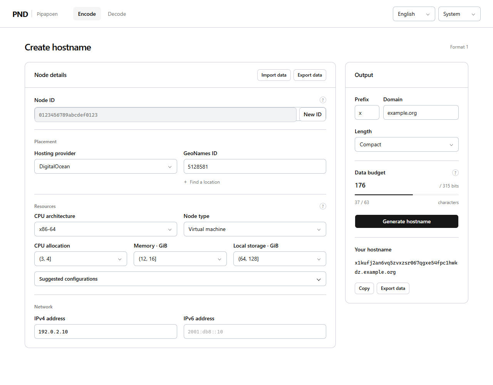
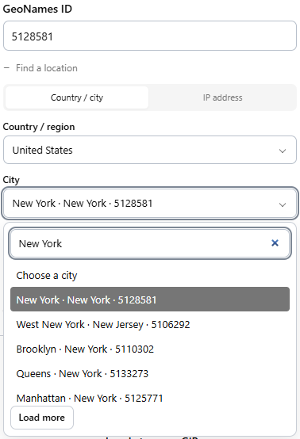
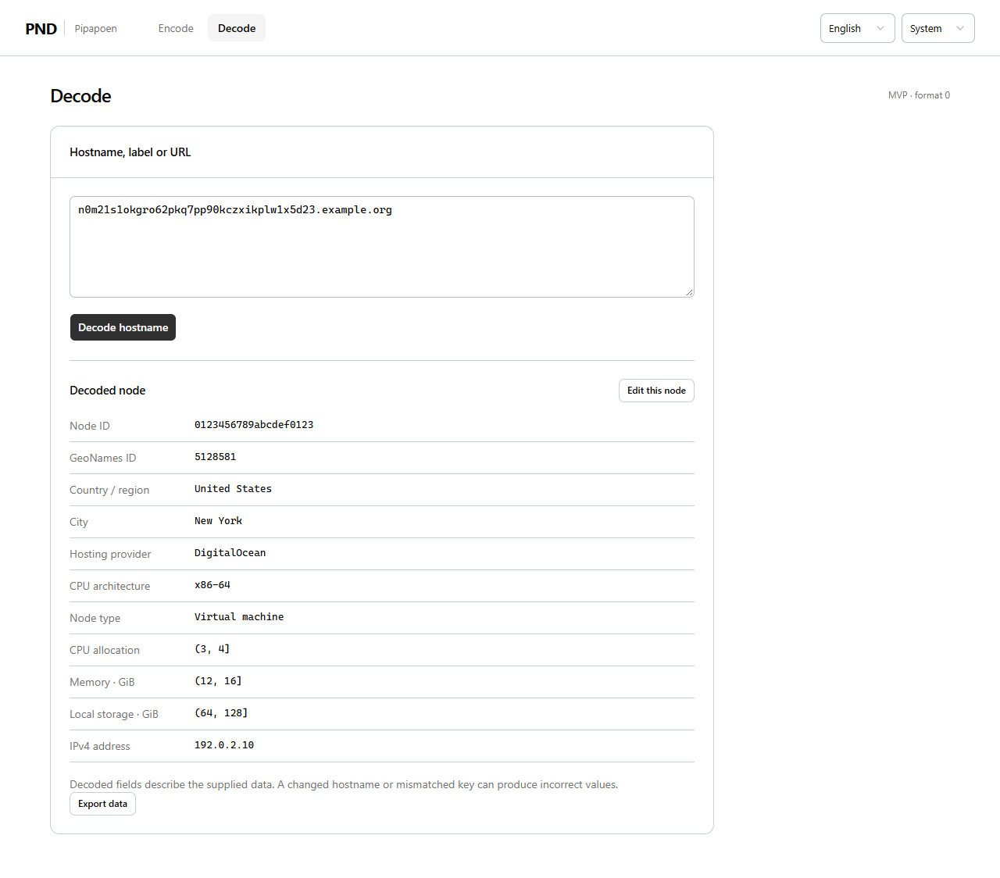

# Pipapoen Node Descriptor

[](https://github.com/Doner357/AGAIN)

[](LICENSE)


[](https://github.com/Pipapoen/pipapoen-node-descriptor/actions/workflows/ci.yml)

PND turns selected node information into a consistent hostname and lets you recover that information later. Choose the details to include, preview the available space, and copy the generated name.

The web interface includes English and Traditional Chinese, light/dark/system themes, location helpers, and data import/export.

[Try PND in your browser](https://pipapoen.github.io/pipapoen-node-descriptor/).

## Deploy with Docker Compose

Install Docker with Compose v2. On Windows, use Docker Desktop with Linux containers.

1. Download `pnd-<version>-compose.zip` from [Releases](https://github.com/Pipapoen/pipapoen-node-descriptor/releases) and extract it.
2. Copy `.env.example` to `.env`. Set your domain and browser address, or keep the defaults for a local trial.
3. Open a terminal in that folder and run:

```sh
docker compose up -d
```

Open `http://localhost:8080` or your configured address. PND generates its encryption key on first startup and preserves it in a Docker volume. Keep a backup of that volume to decode existing names.

The default service is public to anyone who can reach it. See [Deployment and configuration](docs/DEPLOYMENT.md) for SSO, location services, updates, and source builds.

## Create a hostname

1. Keep the generated Node ID, or **Import data** for an existing node.
2. Fill in the fields you want to include. Leave optional fields empty. Provider suggestions help you choose resource combinations.
3. Set the prefix and domain, choose **Compact** or **Fixed**, then select **Generate hostname**.
4. **Copy** the result and **Export data** to retain the node's identity and selections. Create DNS records through your DNS provider.



## Find a location

Open **Find a location** below GeoNames ID. Open the country dropdown and type **United States** into its search box. Then open the city dropdown, search for **New York**, select the city, and press **Use this location**.

The country/city list covers major cities and capitals. Place-name and IP queries are also available when configured.



## Decode or update a node

Open **Decode**, paste a hostname, label, or URL, and select **Decode hostname**. Location results show the GeoNames ID together with available country and city names. Use **Edit this node** to update its fields while retaining the Node ID, or **Export data** to save the recovered information.



Screenshots use example data. Keep exported node files when upgrading the MVP.

## Documentation

- [Deployment and configuration](docs/DEPLOYMENT.md)
- [Technical specification](docs/TECHNICAL.md)
- [Contributing](CONTRIBUTING.md)
- [Release operations](docs/RELEASING.md)
- [Translation contributions](docs/TRANSLATING.md)
- [Third-party notices](THIRD_PARTY_NOTICES.md)
